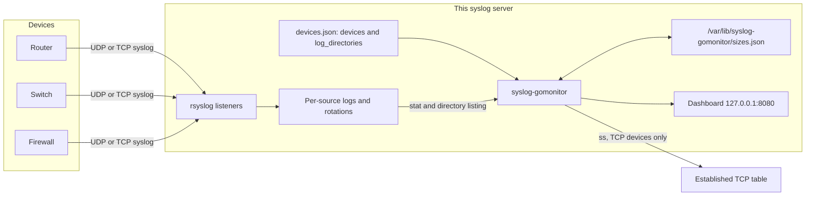
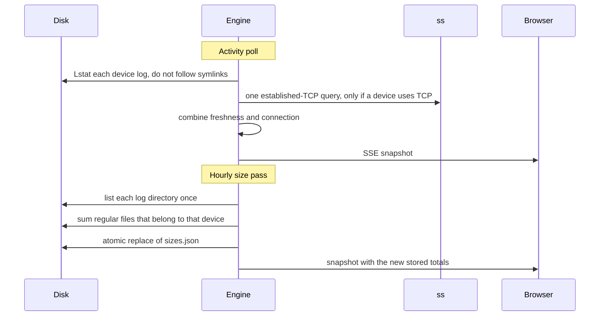
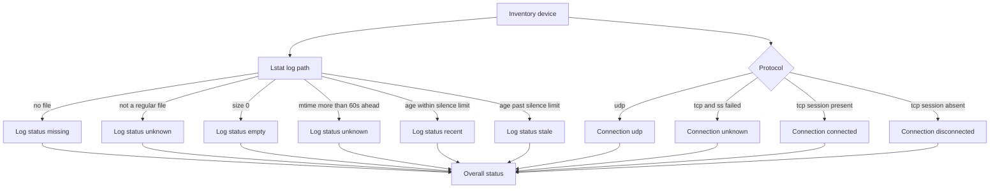

# Architecture and data flow

## Where the monitor sits

Network devices send syslog to the collector that is already running on this
host. That collector writes per-source files. `syslog-gomonitor` only looks at
file metadata and at established TCP sessions. It is not in the forwarding path,
so a stopped monitor does not drop syslog.

## Two schedules

One long-running process does both jobs. They do not share a loop.

| Loop | Default | What it touches | What it avoids |
| --- | --- | --- | --- |
| Activity | Every 5 seconds (`--poll`) | `Lstat` of each current log, and one `ss` call if any device is TCP. A dated name lists that one directory and stats the newest day | File contents, rotations, recursive walks |
| Discovery | About every 30 seconds (`--discover-interval`) | One listing of each `log_directories` entry, then `Lstat` of each new `*.log` file. Days of one dated name are one candidate | File contents, symlinks, rotations inside an address directory |
| Stored size | About every 1 hour (`--size-interval`) | One directory listing per log directory, then `Lstat` of matching names | Decompressing archives, following symlinks, reading bytes |

The size pass also runs at startup when `sizes.json` is missing or older than
the interval. After that it waits until the snapshot is due again, including
across a restart. `--size-interval 0s` disables the in-process walk. The
process then only displays a snapshot written by the separate `size` command.

Replacing `sizes.json` is a write to a temporary file in the same directory,
an fsync, and a rename. A crash during the write leaves the previous snapshot
in place. The target is not replaced when it is a symlink or not a regular file.

## How one device becomes a row

Overall status:

1. Missing, empty, stale, or a TCP session that is actually down is **attention**.
2. Otherwise an unknown log or an unknown connection is **unknown**.
3. Otherwise the device is **healthy**. A healthy TCP device has both a recent
   log and an established session. UDP has no session to check.

A definite problem wins over an unknown signal. A stale log stays attention
even when `ss` itself fails. An `ss` failure is never reported as disconnected.

The hourly measurement is attached to the row afterwards. It does not change
healthy, attention, or unknown. A device with no saved measurement shows
stored size as pending.

## What the process keeps in memory

The engine holds the validated inventory, the latest size measurements, the
latest untracked-file list, and the latest snapshot. Each poll builds a new
snapshot and notifies dashboard subscribers. A slow browser cannot block the
poll: each subscriber has a one-slot buffer and keeps only the newest unread
snapshot.

If `devices.json` changes, the next poll reloads it. A file that does not
validate is logged and the previous inventory stays in service. A successful
reload runs a size measurement when the in-process interval is enabled, so a
newly added device does not wait until the next hour for a stored total.
Adopting or ignoring from the dashboard writes the file and reloads it
immediately.

## Files that are not in the inventory

Discovery looks at `log_directories` only. It does not run when that list is
empty. For each real directory (a symlink is skipped and not followed) it
lists the entries once:

- Each child directory is one candidate. Every regular file ending in `.log`
  directly inside it is a log convention on that card (`syslog.log` and
  `messages.log` share one card). A date in the name (`edge-router-01-20261028-syslog.log`
  or `edge-router-01-2026-10-28-syslog.log`) is one convention,
  `edge-router-01-{date}-syslog.log`, not one card per day. The address is the
  directory name when that name is an IP. `syslog.log` is the suggested file
  when it is present. A directory that already contains a device log is left
  out, and so is a later day of a dated name already in the inventory.
- A regular file directly in the watched directory is a candidate when it is
  not a rotation (`.1`, `.gz`) or an rsyslog state file (`.offset`, `.state`).
- A path or source address already in `devices` or `ignored` is left out.

The active-file size and modification time come from `Lstat`. The file is not
opened. At most 100 candidates are shown, and at most 4096 names in one
directory are examined. The page says when either cap is hit. A directory
with a very large number of names still has to be listed.

Adopt appends one device to `devices.json` and validates the whole file before
replacing it. The stored path is the newest file of the chosen convention.
On each poll the monitor lists that directory when the name contains a
calendar date and stats the newest matching file, so the next day's
`devicename-date-syslog.log` stays the same device. The new object omits
`log_path` when the template already resolves to that file, and uses
`log_directory` when the file is `{watched}/{source_ip}/syslog.log` in
another watched tree. Ignore appends to the `ignored` array. The card's
Ignore button records every log file on that card. A per-address ignore
stores `source_ip`, so that sender stays hidden if the file is recreated.
Ignoring one day of a dated name hides the later days as well. Stop ignoring
deletes that array entry.

## HTTP surface

The listener defaults to `127.0.0.1:8080`. Nothing else is bound.

| Method and path | Response |
| --- | --- |
| `GET /` | Status page. Inventory text is escaped. |
| `GET /api/status` | The same snapshot as JSON. |
| `GET /api/device?source_ip=` | One device's status plus the names in its log directory. Contents are not read. Symlinks are not followed. |
| `GET /events` | Server-Sent Events. Each event is the board markup and the check time. |
| `GET /healthz` | `ok` |
| `POST /api/adopt` | Append one discovered file to the inventory. JSON body: `name`, `log_path`, optional `source_ip`, `protocol`, and `tcp_port`. |
| `POST /api/ignore` | Append that file to `ignored`. JSON body: `log_path`. |
| `POST /api/unignore` | Remove an ignored path. JSON body: `log_path`. |

Selecting a device opens a card with that device's status and the files in
its log directory. The active file, earlier days of a dated name, rotations,
and other names are labeled. The card reads the directory when it opens and
again while it stays open. Search and the device-status cards run in the
browser. They hide rows in the page that was already delivered. **Not in inventory** and **Ignored** also run
in the browser: each one hides the device table and shows the matching list
from the snapshot already delivered. Choosing a card that is already selected
clears that view. None of these cards change the snapshot or the inventory.
`/api/status` changes after a successful adopt, ignore, or stop ignoring,
because those requests rewrite `devices.json` and the process reloads it.

The page tells the operator the monitor is overdue when the snapshot is older
than `monitor_overdue_seconds` (default 180). That is a freshness check on the
monitor itself, not on a device.

The three POST paths accept a JSON body from the dashboard only. The request
must send `X-Requested-With: syslog-gomonitor`. A `Sec-Fetch-Site` header other
than `same-origin`, or an `Origin` whose host is not this listener, is
refused. The path has to be a regular file inside `log_directories` and has to
be one discovery would offer. A failed check does not change `devices.json`.

## Modules

| Package | Responsibility |
| --- | --- |
| `internal/inventory` | Load JSON, reject duplicates and unsafe paths, resolve `{source_ip}`, save `log_directories`, and append adopted or ignored sources |
| `internal/discover` | List untracked sources in `log_directories` without reading them. One child directory is one candidate |
| `internal/logname` | Recognize `YYYYMMDD` and `YYYY-MM-DD` in a filename and choose the newest day |
| `internal/activity` | Classify the current log from `Lstat` |
| `internal/session` | Parse `ss -H -t -n state established` |
| `internal/status` | Combine the two signals |
| `internal/storage` | Hourly on-disk total for one device, and the directory listing behind a device card |
| `internal/snapshot` | Row model, sort, summary, and the `sizes.json` file |
| `internal/engine` | Poll loop, size loop, inventory reload, subscribers |
| `internal/dashboard` | HTML page, including the device detail card |
| `internal/server` | Loopback HTTP server |
| `internal/demo` | Synthetic fleet for a workstation demo |
| `internal/cli` | `serve`, `size`, `check`, `validate`, `configure`, `demo` |

## State on disk

| Path | Written by | Survives restart |
| --- | --- | --- |
| `/etc/syslog-gomonitor/devices.json` | The operator, `install.sh` / `configure` for `log_directories`, and the dashboard for adopt, ignore, and stop ignoring | Yes. Existing device entries are kept. `log_directories` is written at install. `ignored` records sources the page should not offer. |
| `/var/lib/syslog-gomonitor/sizes.json` | The hourly measurement | Yes. Activity history is not stored. |
| Dashboard | Not written | The page is generated from memory on each request. |

Log files under `/var/log` are read, never written, by this program.
