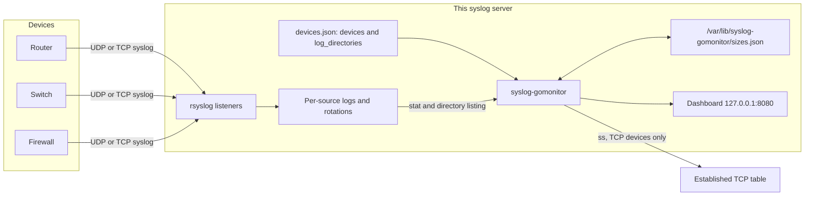
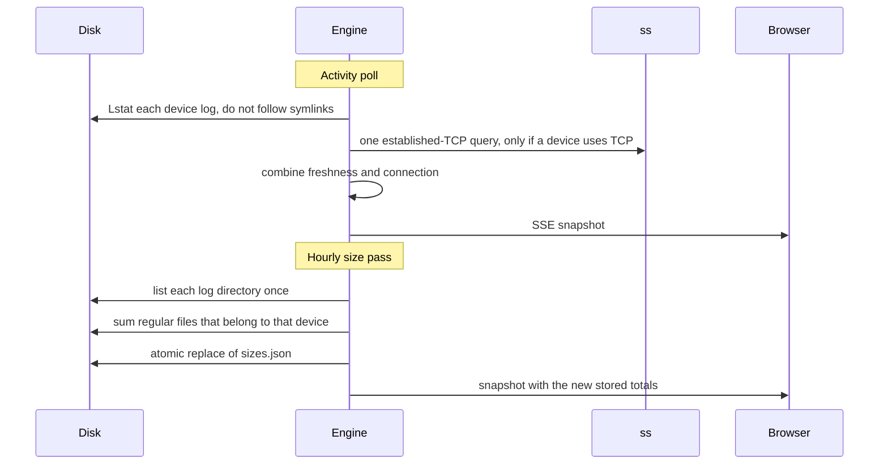
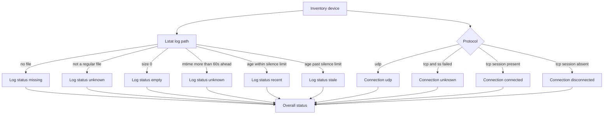

# Architecture and data flow

## Where the monitor sits

Network devices send syslog to the collector that is already running on this
host. That collector writes per-source files. `syslog-gomonitor` only looks at
file metadata and at established TCP sessions. It is not in the forwarding path,
so a stopped monitor does not drop syslog.

## Two schedules

One long-running process does both jobs. They do not share a loop.

| Loop | Default | What it touches | What it avoids |
| --- | --- | --- | --- |
| Activity | Every 5 seconds (`--poll`) | `Lstat` of each current log, and one `ss` call if any device is TCP | File contents, rotations, directory walks |
| Stored size | About every 1 hour (`--size-interval`) | One directory listing per log directory, then `Lstat` of matching names | Decompressing archives, following symlinks, reading bytes |

The size pass also runs at startup when `sizes.json` is missing or older than
the interval. After that it waits until the snapshot is due again, including
across a restart. `--size-interval 0s` disables the in-process walk. The
process then only displays a snapshot written by the separate `size` command.

Replacing `sizes.json` is a write to a temporary file in the same directory,
an fsync, and a rename. A crash during the write leaves the previous snapshot
in place. The target is not replaced when it is a symlink or not a regular file.

## How one device becomes a row

Overall status:

1. Missing, empty, stale, or a TCP session that is actually down is **attention**.
2. Otherwise an unknown log or an unknown connection is **unknown**.
3. Otherwise the device is **healthy**. A healthy TCP device has both a recent
   log and an established session. UDP has no session to check.

A definite problem wins over an unknown signal. A stale log stays attention
even when `ss` itself fails. An `ss` failure is never reported as disconnected.

The hourly measurement is attached to the row afterwards. It does not change
healthy, attention, or unknown. A device with no saved measurement shows
stored size as pending.

## What the process keeps in memory

The engine holds the validated inventory, the latest size measurements, and
the latest snapshot. Each poll builds a new snapshot and notifies dashboard
subscribers. A slow browser cannot block the poll: each subscriber has a
one-slot buffer and keeps only the newest unread snapshot.

If `devices.json` changes, the next poll reloads it. A file that does not
validate is logged and the previous inventory stays in service. A successful
reload runs a size measurement when the in-process interval is enabled, so a
newly added device does not wait until the next hour for a stored total.

## HTTP surface

The listener defaults to `127.0.0.1:8080`. Nothing else is bound.

| Method and path | Response |
| --- | --- |
| `GET /` | Status page. Inventory text is escaped. |
| `GET /api/status` | The same snapshot as JSON. |
| `GET /events` | Server-Sent Events. Each event is the board markup and the check time. |
| `GET /healthz` | `ok` |

Search and the summary-card filters run in the browser. They hide rows in the
page that was already delivered. They do not change the snapshot, the inventory,
or what `/api/status` returns. Choosing a card that is already selected clears
that filter.

The page tells the operator the monitor is overdue when the snapshot is older
than `monitor_overdue_seconds` (default 180). That is a freshness check on the
monitor itself, not on a device.

## Modules

| Package | Responsibility |
| --- | --- |
| `internal/inventory` | Load JSON, reject duplicates and unsafe paths, resolve `{source_ip}`, and save `log_directories` |
| `internal/activity` | Classify the current log from `Lstat` |
| `internal/session` | Parse `ss -H -t -n state established` |
| `internal/status` | Combine the two signals |
| `internal/storage` | Hourly on-disk total for one device |
| `internal/snapshot` | Row model, sort, summary, and the `sizes.json` file |
| `internal/engine` | Poll loop, size loop, inventory reload, subscribers |
| `internal/dashboard` | HTML page |
| `internal/server` | Loopback HTTP server |
| `internal/demo` | Synthetic fleet for a workstation demo |
| `internal/cli` | `serve`, `size`, `check`, `validate`, `configure`, `demo` |

## State on disk

| Path | Written by | Survives restart |
| --- | --- | --- |
| `/etc/syslog-gomonitor/devices.json` | The operator, and `install.sh` / `configure` for `log_directories` | Yes. Device entries are kept. `log_directories` is written at install and can be edited in this file. |
| `/var/lib/syslog-gomonitor/sizes.json` | The hourly measurement | Yes. Activity history is not stored. |
| Dashboard | Not written | The page is generated from memory on each request. |

Log files under `/var/log` are read, never written, by this program.
