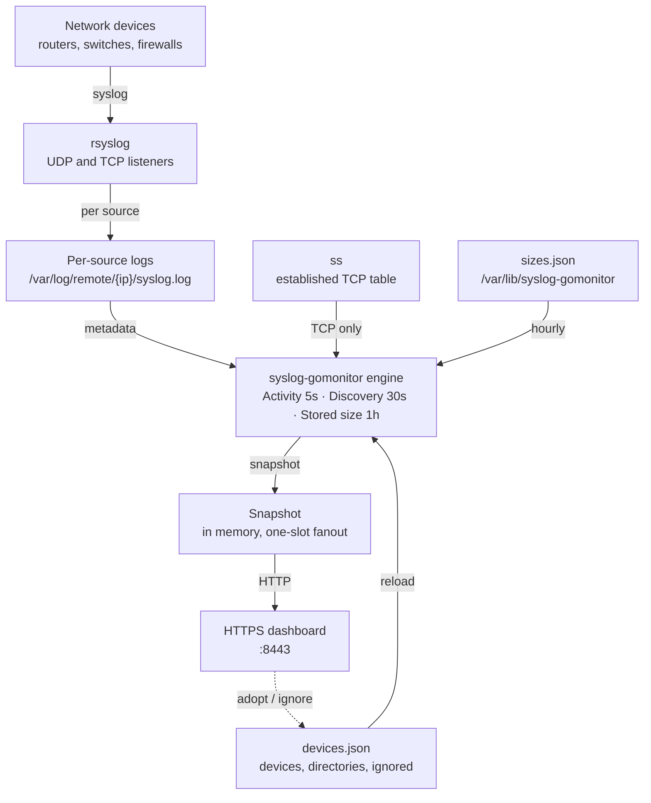

# Syslog source monitor — data flow

Release 1.2.0. This is the team copy of the data-flow canvas. It describes how a
message, a status check, and a stored-size measurement move on one syslog
server. The packaged dashboard is HTTPS on port 8443. `install.sh --http`, or
a package built with `./release/build.sh --http`, keeps HTTP on `127.0.0.1:8080`.

`syslog-gomonitor` stats files and reads the established-TCP table. It does
not receive syslog, does not change rsyslog, and does not read log contents.

## Off the forwarding path

Devices talk to rsyslog. Stopping the monitor does not drop messages. A bad
inventory edit is refused, and the previous device list stays in service.

| Cadence | Default |
| --- | --- |
| Activity poll | 5s (`--poll`) |
| Discovery | 30s (`--discover-interval`) |
| Stored size | 1h (`--size-interval`) |
| Dashboard | HTTPS `:8443` on the host |

## Data flow on this server

Solid arrows are reads. The dashed arrow is the dashboard writing
`devices.json`. The engine reads modification time and size only.

The canvas highlights one path at a time. These are those paths:

| Path | Arrows that stay lit |
| --- | --- |
| Collector | syslog, per source |
| Activity | metadata, reload, TCP only, snapshot, HTTP |
| Discovery | metadata, reload, snapshot, HTTP |
| Stored size | metadata, hourly, snapshot, HTTP |
| Adopt and ignore | reload, snapshot, HTTP, and the dashed write back to `devices.json` |

### Collector

Network devices send UDP or TCP syslog to rsyslog. rsyslog writes one regular
file per source, usually `/var/log/remote/{source_ip}/syslog.log`. The monitor
is not on this path.

### Activity

Every 5 seconds the engine reloads `devices.json` when its modification time
changed, `Lstat`s each current log, and runs `ss` once if any device uses TCP.
It publishes a snapshot. The browser receives it on `GET /events`.

### Discovery

About every 30 seconds the engine lists each directory in `log_directories`
and `Lstat`s new logs. It does not run when that list is empty. Each child
directory is one candidate. Every regular file ending in `.log` directly
inside it is a choice on that card, so `syslog.log` and `messages.log` share
one card and the operator picks which file to monitor. A calendar date in
the filename is part of that choice: `edge-router-01-20261028-syslog.log`
and `edge-router-01-20261029-syslog.log` are one convention. `syslog.log` is
preselected when it is present. The address is the directory name when that
name is an IP. A regular file sitting directly in the watched directory is
also a candidate, unless it is a rotation (`.1`, `.gz`) or an rsyslog state
file (`.offset`, `.state`). Symlinks are not followed. A path or source
address already in `devices` or `ignored` is left out, and so is a directory
that already holds a device log. A later day of a dated name that is already
tracked or ignored is left out too.

The page shows at most 100 untracked sources and examines at most 4096 names in
one directory. `--discover-interval 0s` checks once at startup.

### Stored size

About once an hour the engine lists each log directory and sums the active
file plus its rotations. The result is written to
`/var/lib/syslog-gomonitor/sizes.json` by a temp file, an fsync, and a rename.
The first pass also runs at startup when that file is missing or older than
the interval. `--size-interval 0s` only displays a snapshot written by the
`size` command. Stored size is attached to a row afterwards and does not
change healthy, attention, or unknown.

### Adopt and ignore

**Adopt** appends one device to `devices.json` and validates the whole file
before replacing it. The stored path is the convention selected on the card.
When that name contains a calendar date, later polls follow the newest
matching file in the same directory. The new object omits `log_path` when the
template already resolves to that file, and uses `log_directory` when the file
is `{watched}/{source_ip}/syslog.log` in another watched tree. **Ignore**
appends every log file on the card to `ignored`. A per-address ignore also
stores `source_ip`, so that sender stays hidden if the file is recreated.
Ignoring one day of a dated name hides later days of that name. **Stop
ignoring** deletes that entry. The process reloads the inventory immediately.
A failed check does not change the file.

## What each loop touches

| Loop | Default | Reads | Leaves alone |
| --- | --- | --- | --- |
| Activity | 5s | `Lstat` of each current log, and one `ss` call when a device uses TCP. A dated name lists that directory and stats the newest day | File contents, rotations, recursive walks |
| Discovery | 30s | One listing of each log directory, then `Lstat` of each new `*.log` file. Days of one dated name are one candidate | Contents, symlinks, rotations inside an address directory |
| Stored size | 1h | One listing per log directory, then `Lstat` of the active file, its rotations, and every day of a dated series | Decompressing archives, following symlinks, reading bytes |

## How one device becomes a row

Overall status is the combination of log freshness and, for TCP, the session.
A definite problem outranks an unknown signal.

| What the check saw | Overall |
| --- | --- |
| Recent log, and UDP or an established TCP session | Healthy |
| Missing, empty, or stale log | Needs attention |
| Recent log, but no TCP session to the configured port | Needs attention |
| Unknown log or `ss` failed, and nothing is definitely wrong | Unknown |
| Stale log, and `ss` itself failed | Needs attention |

UDP has no session to check. An `ss` failure is never reported as disconnected.
A modification time more than 60 seconds in the future is an unknown log.

1. Missing, empty, stale, or a TCP session that is actually down is **attention**.
2. Otherwise an unknown log or an unknown connection is **unknown**.
3. Otherwise the device is **healthy**.

## Dashboard cards

The device table stays up until **Not in inventory** or **Ignored** is
selected. Those two cards appear only when `log_directories` is set. Their
counts are not part of the device total. Selecting either card again, or any
device card, brings the table back and loads the latest list. While either
list is open, live updates refresh the device table and the summary counts,
and leave that list in place so a form keeps what was typed. A live update
keeps the open card.

| Card | Click |
| --- | --- |
| Devices | Clear a status filter and show the device table. |
| Healthy, Needs attention, Unknown | Show only that status. Click the selected card again to clear it. |
| Stored logs | Not a filter. Total bytes from successful size measurements. |
| Not in inventory | Hide the device table and list one card per untracked directory or loose file. |
| Ignored | Hide the device table and list paths recorded in `ignored`. |

Selecting a device row opens a card with that device's status and the files
in its log directory. The card calls `GET /api/device?source_ip=` and does not
change the inventory. Summary-card clicks run in the browser and do not change
the snapshot. Adopt, ignore, and stop ignoring are the actions that rewrite
`devices.json`.

## What crosses the HTTP boundary

The installed listener is HTTPS on port 8443 on every interface. `install.sh --http`, or a package built with `./release/build.sh --http`, listens on `127.0.0.1:8080` without TLS. `serve` without a certificate stays on HTTP. The lab publishes HTTPS on the host's port 8443.

| Request | Direction | Payload |
| --- | --- | --- |
| `GET /` | Engine to browser | HTML status page. Inventory text is escaped. |
| `GET /api/status` | Engine to browser | The same snapshot as JSON. |
| `GET /api/device?source_ip=` | Engine to browser | One device's status and the names in its log directory. Contents are not included. |
| `GET /events` | Engine to browser | Server-Sent Events: board markup and check time. |
| `GET /healthz` | Engine to browser | The text `ok`. |
| `POST /api/adopt` | Browser to `devices.json` | Name, log path, protocol. Optional source IP and TCP port. |
| `POST /api/ignore` | Browser to `devices.json` | Log path of a file discovery would offer. |
| `POST /api/unignore` | Browser to `devices.json` | Log path to remove from `ignored`. |

POST requires the header `X-Requested-With: syslog-gomonitor` and a
same-origin fetch. A `Sec-Fetch-Site` value other than `same-origin`, or an
`Origin` whose host is not this listener, is refused. A path outside
`log_directories`, a symlink, or a file discovery would not offer does not
change the inventory.

Search and the device-status cards hide rows already on the page. **Not in
inventory** and **Ignored** swap that table for their own list. None of those
clicks change `/api/status` until adopt, ignore, or stop ignoring succeeds.

The page calls itself overdue when the snapshot is older than
`monitor_overdue_seconds` (default 180). That is a freshness check on the
monitor, not on a device.
